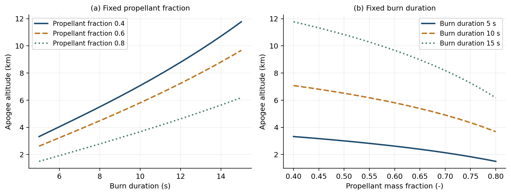

# AE 370 Group Project 1 — Vertical Rocket Ascent

**Repository:** [https://github.com/justinchiang0207/AE370-Sounding-Rocket-Ascent---Initial-Value-Problem](https://github.com/justinchiang0207/AE370-Sounding-Rocket-Ascent---Initial-Value-Problem)

**Group 18 · University of Illinois Urbana-Champaign · Fall 2026**  
Maria Dalton, Morgan Waller, Yogeshwari Kant, Justin Chiang

A custom fourth-order Runge–Kutta integrator solves a vertical rocket model with variable mass, exponential atmospheric density, and signed quadratic drag. The project examines how burn duration and propellant mass fraction affect apogee at fixed thrust and dry mass, and quantifies the corresponding atmospheric drag penalty.

The solver is implemented from scratch. It does not call an external ODE solver.

## Main findings

- The nominal rocket reaches **5806.87 m** at **32.95877 s**.
- The 357-case grid uses burn durations 5–15 s and propellant fractions 0.40–0.80.
- Apogee increases with duration and decreases with propellant fraction at every sampled comparison under the specified constraints.
- Atmospheric apogee is 38.68–87.41% below the analytical vacuum result.
- The largest final step-halving changes are 0.00264 m and 0.0000163 s.
- Nominal adjacent-step convergence orders are approximately 4.184, 4.098, and 4.050.

These are results for an illustrative mathematical model, not experimentally validated flight predictions. Fixed thrust means a longer burn adds impulse. Adding propellant at a fixed duration adds mass without adding impulse. The implied exhaust velocity varies; this is **not a fixed-specific-impulse motor comparison**.



## Quick start

Use Python 3.11 or later (tested with Python 3.12.14). The pinned NumPy version requires Python 3.11 or later. From this folder:

```sh
python -m venv .venv
```

Activate the environment:

```sh
# Linux / macOS
source .venv/bin/activate
# Windows PowerShell (use this instead)
.venv\Scripts\Activate.ps1
```

Install dependencies and reproduce all numerical results:

```sh
python -m pip install -r requirements.txt
python reproduce.py --skip-latex
```

The command runs seven tests and all five experiments, overwriting generated data and figures. Every experiment uses deterministic inputs; small differences in the final floating-point digits are possible across platforms. `data/environment.json` records the executed environment, and `data/execution_log.txt` records the test and experiment output. A failed test or failed numerical tolerance stops reproduction with a nonzero exit code.

To also build the report, install a LaTeX distribution with `latexmk` or `pdflatex` and run:

```sh
python reproduce.py
```

If LaTeX is unavailable, the numerical pipeline still runs and reports that the PDF must be compiled separately. No TeX shell escape is needed.

## Report and Overleaf

`main.pdf` is the compiled report; `main.tex` is the editable source. Upload the **entire ZIP** to Overleaf as a new project and select `main.tex` with the **pdfLaTeX** compiler. To update an existing project, upload its replacement files and folders with the same names.

The report needs `figures/`, `data/results_table.tex`, and `rocket_solver.py` as well as `main.tex`. The appendix reads the executed solver with `listings`, and the Results table reads generated numerical rows. Compiling does not execute Python. Long code belongs in the appendix; the body contains the governing equations, method, verification, and engineering analysis. The full experiment code is in this repository.

To compile after a text-only edit without rerunning experiments:

```sh
latexmk -pdf -interaction=nonstopmode -halt-on-error main.tex
```

## Upload or update this GitHub repository

The repository has been created at [https://github.com/justinchiang0207/AE370-Sounding-Rocket-Ascent---Initial-Value-Problem](https://github.com/justinchiang0207/AE370-Sounding-Rocket-Ascent---Initial-Value-Problem). Its URL is already included in `main.tex` and the compiled `main.pdf`.

1. Extract the project ZIP. Open the repository and use **uploading an existing file** (for an empty repository) or **Add file → Upload files**.
2. Upload **the contents** of the extracted project folder, keeping `data/` and `figures/` as directories. The README belongs at the repository root. Do not upload only the ZIP.
3. Include the Python files, requirements, README, generated data, figures, LaTeX source, and PDF. Exclude `.venv/`, `__pycache__/`, and LaTeX auxiliary files; `.gitignore` covers them when using Git.
4. Commit the upload, then verify that the files and README display correctly and that the report's repository link opens this page. If updating an earlier upload, replace the existing files with the same names.
5. Upload the same package to Overleaf, or replace `main.tex` in an existing copy of this project. After any further report edits, recompile and update both `main.tex` and `main.pdf` on GitHub before submitting the PDF through the course's prescribed channel.

The repository is public, so the uploaded files will be visible to anyone. The report source and PDF in this package already contain the actual URL; no placeholder needs to be replaced. GitHub hosting can be considered for the up-to-three-point bonus, with grading at the instructor's discretion.

## Code and output organization

| File | Responsibility |
| --- | --- |
| `rocket_solver.py` | Parameters, derivative evaluation, RK4, phase-aligned burnout, bisection apogee detection |
| `plot_trajectory.py` | Nominal trajectory CSV and individual/combined trajectory figures |
| `convergence_study.py` | Reference refinement, observed orders, log–log convergence figure |
| `validation.py` | Independent ballistic and powered variable-mass vacuum checks |
| `parameter_evaluation.py` | All 25 powered/coast step combinations, cost counts and Jacobian diagnostics |
| `engineering_results.py` | 357-case grid, three-level refinement, exact vacuum comparisons, parameter figures and report table |
| `plot_style.py` | Shared plot appearance and PDF/PNG export |
| `test_solver.py` | Seven numerical and implementation tests |
| `reproduce.py` | One-command execution, environment/log recording, optional report compilation |
| `requirements.txt` | Tested dependency versions |
| `data/` | Reproducible CSV, JSON, log, and generated LaTeX table |
| `figures/` | Vector PDF and raster PNG figures |
| `main.tex`, `main.pdf` | Report source and compiled report |
| `SUBMISSION_CHECKLIST.md` | Rubric evidence and remaining team/publication checks |

Run individual experiments directly, for example `python engineering_results.py`. Run only the tests with `python -m unittest -v test_solver`.

## Numerical design

The state is `(altitude, velocity, mass)` with upward-positive velocity. Drag uses `v * abs(v)` so it opposes motion. Powered steps end exactly at burnout, use the powered equations in all stages, and then switch to coast. Apogee is located by 45 bisection iterations on fractional RK4 steps. The solver raises an error if apogee is not reached within the time limit or if a launch from rest cannot lift off immediately.

Nominal parameters: initial/dry masses 50/20 kg, thrust 2500 N, burn time 10 s, drag coefficient 0.45, area 0.0314 m², sea-level density 1.225 kg/m³, scale height 8500 m, gravity 9.81 m/s². Initial height and velocity are zero.

The nominal cost study tests all 25 phase-step pairs drawn from `{0.1, 0.25, 0.5, 1, 2}` s. Uniform 1 s steps are the cheapest tested setting passing 0.1 m and 0.001 s nominal tolerances. This does not establish that 1 s is suitable for every other configuration.

The engineering grid uses 21 burn times (5:0.5:15 s) and 17 fractions (0.40:0.025:0.80). It keeps dry mass fixed and sets `initial_mass = dry_mass / (1 - fraction)`. Each atmospheric case runs at 0.5, 0.25, and 0.125 s; both successive differences must meet the tolerances. Reported atmospheric results use 0.125 s. These differences are refinement evidence, not rigorous exact-error bounds. Vacuum apogees are computed analytically, and a separate 0.125 s numerical vacuum run checks that formula for every grid point. A generous configuration-dependent time limit accommodates long vacuum coast phases.

The mathematical model omits wind, attitude, lift, variable gravity, and Mach/Reynolds effects on drag. It has not been compared with measured flight data. The sampled maximum is a boundary maximum under the specified constraints; no global motor optimum is claimed.

## Data conventions

CSV headings include units. `propellant_fraction` is dimensionless, and `drag_penalty_percent` uses vacuum apogee as its denominator. `engineering_results.csv` has one row per physical grid point and includes both refinement differences and vacuum validation errors. `engineering_summary.json` supplies extrema, monotonicity checks, worst numerical differences, and nominal centered sensitivities. `results_table.tex` is generated from nine representative grid points; do not edit its numbers by hand.

## Sources and AI acknowledgment

The numerical-method presentation primarily follows the supplied AE 370 Fall 2026 Lectures 10–12 (Goza). The report identifies the relevant lectures in the text. The project statement and course slides are not redistributed in this repository. Rocket modeling assumptions and independently derived analytical solutions are identified in the report.

The group brainstormed the idea and attempted the initial report and code before using ChatGPT for review, corrections, and help when stuck. AI also assisted with analytical checks, execution of parameter studies, figures, Results interpretation, and overall formatting and language revisions. The report acknowledgment describes this workflow and the group's review of the AI output. Group roles and percentages are retained from the supplied document; the group must verify they accurately describe its contributions before submission.
